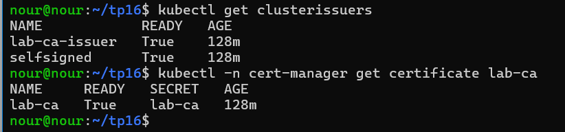
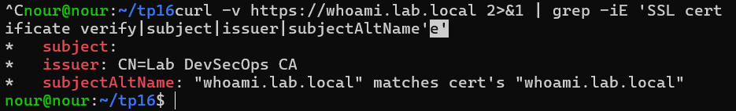
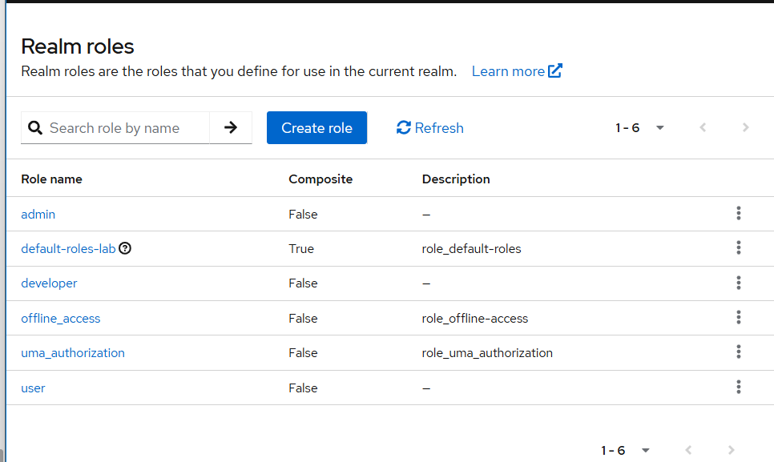
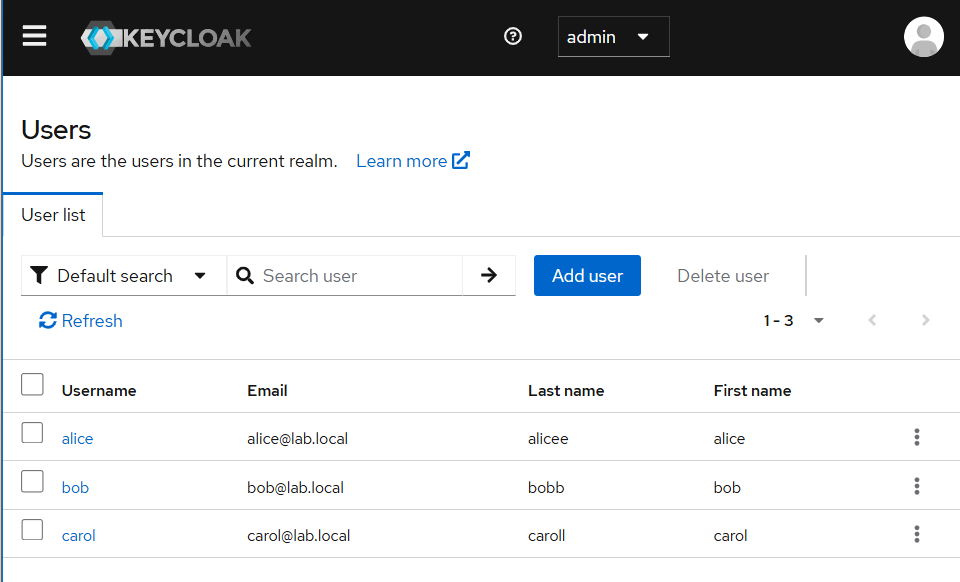
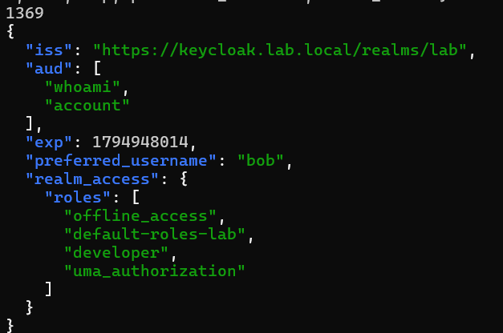
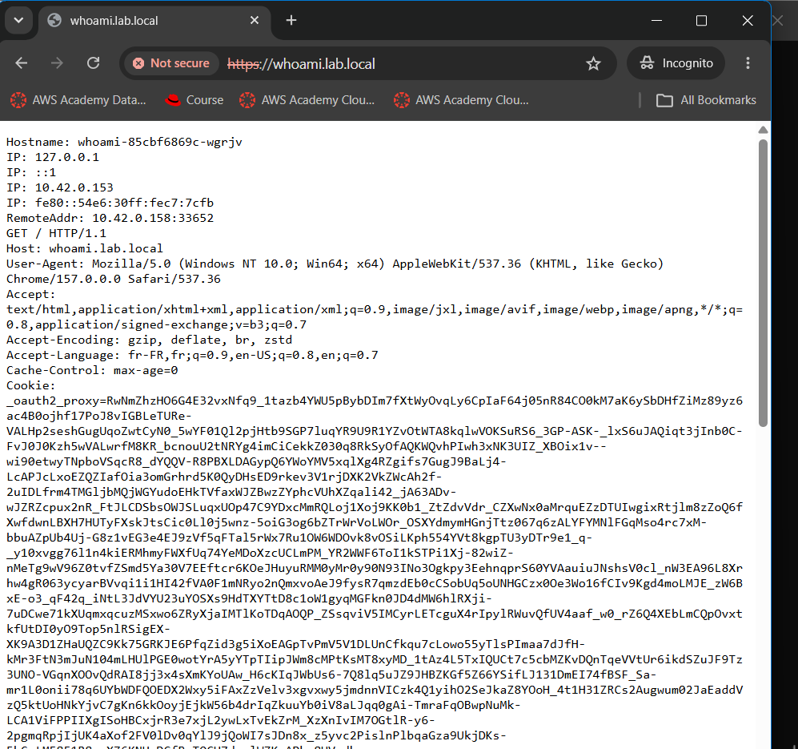
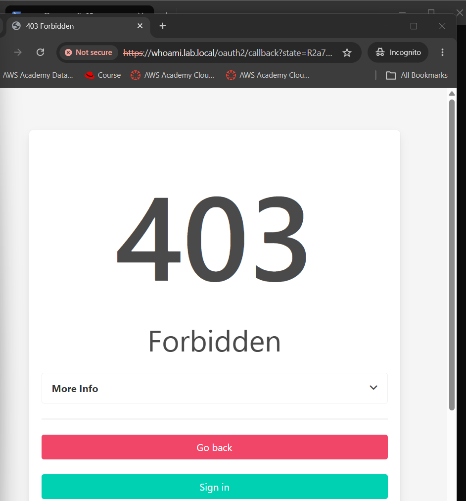

# TP16 : HTTPS avec cert-manager et IAM avec Keycloak (OIDC)

TP du Master DevOps & Cloud Computing (ISET Tozeur). Cluster K3s mono-nœud, Traefik comme Ingress.
Objectif : chiffrer les échanges avec une autorité de certification de lab gérée par cert-manager,
puis protéger l'application `whoami` avec Keycloak (OpenID Connect) et oauth2-proxy, sans modifier son code.

## Architecture                                                             Navigateur --HTTPS--> Traefik (Ingress, TLS par cert-manager)
|
v
oauth2-proxy --OIDC--> Keycloak (realm lab, rôles user/developer/admin)
|
v (si rôle developer ou admin)
whoami (reçoit X-Auth-Request-*)                                            
## Contenu du dépôt

| Fichier | Rôle |
|---|---|
| `manifests/00-app.yaml` | Namespace `tp16` et application whoami |
| `manifests/05-coredns-custom.yaml` | Résolution de `*.lab.local` à l'intérieur du cluster |
| `manifests/10-issuers.yaml` | ClusterIssuer autosigné, Certificate de la CA `lab-ca`, ClusterIssuer `lab-ca-issuer` |
| `manifests/20-ingress-tls.yaml` | Ingress HTTPS de whoami (certificat automatique, entrée `websecure`) |
| `manifests/30-keycloak.yaml` | Keycloak en mode développement (H2 en mémoire, lab uniquement) |
| `manifests/40-oauth2-proxy.yaml` | oauth2-proxy avec `--allowed-role=developer` et `--allowed-role=admin` |
| `lab-ca.crt` | Certificat **public** de la CA de lab (la clé privée n'est jamais exportée) |
| `captures/` | Captures d'écran des livrables |

## Environnement

- Ubuntu avec K3s (nœud unique, IP `192.168.237.130`), kubectl et Helm
- Noms ajoutés dans `/etc/hosts` : `whoami.lab.local` et `keycloak.lab.local`
- cert-manager installé avec Helm (`--set crds.enabled=true`)

## Partie 1 : cert-manager et CA de lab

```bash
helm repo add jetstack https://charts.jetstack.io && helm repo update
helm install cert-manager jetstack/cert-manager -n cert-manager --create-namespace --set crds.enabled=true
kubectl apply -f manifests/10-issuers.yaml
kubectl get clusterissuers
kubectl -n cert-manager get certificate lab-ca
```

Dans `10-issuers.yaml`, le ClusterIssuer `lab-ca-issuer` est de type `ca` et utilise le Secret `lab-ca`.
Le certificat public de la CA est exporté (`ca.crt` uniquement) puis ajouté au magasin de confiance de la VM :

```bash
kubectl -n cert-manager get secret lab-ca -o jsonpath='{.data.ca\.crt}' | base64 -d > lab-ca.crt
sudo cp lab-ca.crt /usr/local/share/ca-certificates/lab-ca.crt && sudo update-ca-certificates
```



## Partie 2 : Ingress HTTPS

L'Ingress whoami porte l'annotation `cert-manager.io/cluster-issuer: lab-ca-issuer`, un bloc `tls`
(`whoami-tls`) et l'entrée `websecure` uniquement. cert-manager crée le Certificate, la CertificateRequest
puis le Secret TLS lu par Traefik.

```bash
kubectl apply -f manifests/20-ingress-tls.yaml
kubectl -n tp16 get certificate,certificaterequest
curl -v https://whoami.lab.local
```

Le certificat est émis par `Lab DevSecOps CA`, le SAN contient `whoami.lab.local`, et `curl` le vérifie sans option `-k`.



**Suppression du Secret `whoami-tls` :** cert-manager détecte l'absence du Secret et le recrée automatiquement
en réémettant le certificat.

**Renouvellement anticipé :** le champ `spec.renewBefore` du Certificate fixe combien de temps avant
l'expiration le certificat est renouvelé (la durée par défaut est de 90 jours).

## Partie 3 : Keycloak

```bash
kubectl apply -f manifests/05-coredns-custom.yaml     # IP du nœud, puis redémarrage de coredns
kubectl -n kube-system rollout restart deploy/coredns
kubectl create namespace keycloak
kubectl -n keycloak create secret generic keycloak-admin --from-literal=password="$(openssl rand -base64 18)"
kubectl apply -f manifests/30-keycloak.yaml
kubectl -n keycloak rollout status deploy/keycloak
```

La résolution DNS interne est nécessaire pour qu'oauth2-proxy joigne Keycloak par le même nom que le navigateur
(sinon l'émetteur `iss` des jetons ne correspond pas). Keycloak est servi en HTTPS sur `https://keycloak.lab.local`
avec un certificat émis par la même CA.

## Partie 4 : Realm, rôles, utilisateurs et client

Configuration dans la console Keycloak :

- realm `lab` ;
- rôles de realm `user`, `developer`, `admin` ;
- utilisateurs `alice` (admin), `bob` (developer), `carol` (user), mots de passe non temporaires ;
- client `whoami` : client confidentiel, Standard flow uniquement, redirect URI `https://whoami.lab.local/oauth2/callback`,
  mapper **Audience** qui ajoute `whoami` au claim `aud`.

Rôles du realm `lab` :



Utilisateurs du realm `lab` :



### Jeton JWT décodé (utilisateur bob)

Le flux *password* a été activé temporairement (Direct access grants) uniquement pour observer le jeton, puis désactivé.

```bash
echo "$TOKEN" | cut -d. -f2 | tr '_-' '/+' | base64 -d 2>/dev/null | jq '{iss, aud, exp, preferred_username, realm_access}'
```

`iss` est le realm `lab`, `aud` contient `whoami` et `realm_access.roles` contient `developer`.



## Partie 5 : oauth2-proxy

```bash
kubectl -n tp16 create secret generic oauth2-proxy \
  --from-literal=client-secret=<secret-du-client> \
  --from-literal=cookie-secret="$(openssl rand -base64 32 | tr -- '+/' '-_' | head -c 32)"
kubectl -n tp16 create secret generic lab-ca-public --from-file=ca.crt=lab-ca.crt
kubectl apply -f manifests/40-oauth2-proxy.yaml
```

L'Ingress whoami pointe vers le Service `oauth2-proxy`. Le flux utilisé est l'Authorization Code avec PKCE (S256) :
le mot de passe n'est saisi que sur Keycloak, jamais sur l'application.

**bob (rôle developer) : accès autorisé.** whoami reçoit les en-têtes `X-Auth-Request-User` et `X-Auth-Request-Email`.



**carol (rôle user) : accès refusé (403).**



**Déconnexion :** `/oauth2/sign_out` supprime seulement le cookie d'oauth2-proxy. La session Keycloak a son propre cookie
sur `keycloak.lab.local` : elle survit (SSO) et une nouvelle connexion se fait sans ressaisir le mot de passe.

## Problèmes rencontrés

- **cert-manager en `CrashLoopBackOff` (`exec format error`)** : image du contrôleur corrompue dans le cache containerd,
  réglée en arrêtant le Deployment, en supprimant l'image avec `k3s crictl rmi`, puis en la retéléchargeant.
- **Keycloak lent au premier démarrage** : le pic de CPU ralentit temporairement l'API server K3s (même VM).
- **Keycloak en base H2 en mémoire** : le realm est perdu à chaque redémarrage du pod ; en production on utilise PostgreSQL.
- **Ingress en conflit** : les Ingress des TP14 et TP15 déclaraient aussi `whoami.lab.local` ; ils ont été supprimés
  pour que Traefik route vers l'Ingress du TP16.
- **`args` invalide dans oauth2-proxy** : une ligne `env:` collée à `--allowed-role=admin` rendait le Deployment invalide.

## Sécurité

Ce dépôt ne contient ni la clé privée de la CA (`tls.key`), ni le secret du client Keycloak, ni le mot de passe administrateur,
ni cookie ou jeton. Seul le certificat public `lab-ca.crt` est fourni. Keycloak en mode développement est réservé au lab.
